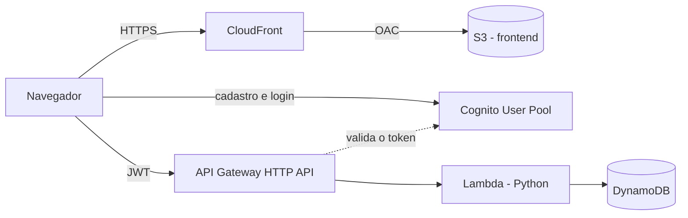

# Serverless Expense Tracker

Aplicação web totalmente serverless para gestão de despesas pessoais na AWS, com autenticação JWT, infraestrutura como código e pipeline de CI/CD. Opera dentro do AWS Free Tier.

**Demo:** _cole aqui a URL do CloudFront depois do deploy_

## Arquitetura



O navegador baixa o site pelo CloudFront, faz login no Cognito e envia o token JWT em cada chamada. O API Gateway valida o token antes de chamar a Lambda; requisições sem token válido são recusadas sem gerar execução.

| Camada | Serviço | Por que |
|---|---|---|
| Frontend | S3 + CloudFront | Bucket privado, acessível só pela CDN via Origin Access Control, com HTTPS |
| Autenticação | Cognito (tier Lite) | Cadastro com verificação de e-mail e tokens JWT, sem guardar senhas na aplicação |
| API | API Gateway HTTP API | Autorizador JWT nativo, CORS restrito ao domínio do site, throttling |
| Backend | Lambda (Python 3.13, arm64) | Uma função com roteamento, validação de entrada e isolamento por usuário |
| Dados | DynamoDB | Partition key `userId` + sort key `EXP#<id>`: cada usuário só acessa os próprios itens |
| IaC | AWS SAM | Toda a infraestrutura descrita em `template.yaml` |
| CI/CD | GitHub Actions | Testes e lint em todo PR; deploy automático na `main` via OIDC, sem chaves salvas |

## Funcionalidades

- Cadastro, confirmação por e-mail e login
- Criar, editar e excluir despesas (valor, descrição, categoria, data)
- Navegação mês a mês com total e distribuição por categoria
- Layout responsivo com tema claro e escuro

## Decisões técnicas

- **Usuário vem do token, nunca do body.** O `userId` é o claim `sub` do JWT validado pelo API Gateway, então um cliente não consegue ler dados de outro usuário.
- **HTTP API em vez de REST API.** Mais simples, mais barata e com autorizador JWT pronto.
- **`Decimal` para dinheiro.** Evita erros de arredondamento de `float` em centavos.
- **Escritas condicionais.** `PUT` e `DELETE` usam `attribute_exists(sk)`, então um id inexistente devolve 404 em vez de criar um item novo.
- **Menor privilégio.** A Lambda só tem acesso CRUD à própria tabela; o bucket só aceita leitura vinda desta distribuição do CloudFront.
- **Sem credenciais de longa duração.** O pipeline assume uma role IAM via OIDC, restrita a este repositório e à branch `main`.

## API

Todas as rotas exigem o header `Authorization` com o ID token do Cognito.

| Método | Rota | Descrição |
|---|---|---|
| GET | `/expenses?month=AAAA-MM` | Lista despesas (filtro opcional por mês) |
| POST | `/expenses` | Cria despesa |
| PUT | `/expenses/{id}` | Atualiza campos de uma despesa |
| DELETE | `/expenses/{id}` | Exclui despesa |
| GET | `/summary?month=AAAA-MM` | Total e gastos por categoria no mês |

## Estrutura do repositório

```
├── template.yaml               # infraestrutura (AWS SAM)
├── backend/
│   ├── src/app.py              # código da Lambda
│   ├── tests/test_app.py       # testes com pytest + moto
│   └── requirements-dev.txt
├── frontend/                   # HTML, CSS e JavaScript sem frameworks
├── scripts/deploy.sh           # deploy completo com um comando
└── .github/workflows/ci-cd.yml # pipeline de CI/CD
```

## Como rodar

### Pré-requisitos

- Conta AWS no plano Free, com MFA no root e um orçamento (AWS Budgets) de alerta
- Usuário IAM com as políticas `AdministratorAccess` e `SignInLocalDevelopmentAccess`
- [AWS CLI v2](https://docs.aws.amazon.com/cli/latest/userguide/getting-started-install.html) 2.32 ou mais novo, [AWS SAM CLI](https://docs.aws.amazon.com/serverless-application-model/latest/developerguide/install-sam-cli.html) e Python 3.13

Login no CLI com credenciais temporárias, sem access keys:

```bash
aws login --profile dev
export AWS_PROFILE=dev
```

### Testes

```bash
pip install -r backend/requirements-dev.txt
pytest -q backend/tests
```

Os testes usam `moto` para simular o DynamoDB e não acessam a AWS.

### Deploy

```bash
./scripts/deploy.sh                 # usa a região padrão do seu perfil
./scripts/deploy.sh expense-tracker sa-east-1   # ou informe stack e região
```

O script faz o build, cria a infraestrutura, restringe o CORS ao domínio do CloudFront, gera o `frontend/config.js`, envia o site ao S3 e invalida o cache. No final ele mostra a URL do site.

### CI/CD

1. No IAM, crie o provedor OIDC `token.actions.githubusercontent.com` (audience `sts.amazonaws.com`).
2. Crie uma role do tipo **Web identity** para esse provedor, limitada a este repositório e à branch `main`.
3. No GitHub, em **Settings → Secrets and variables → Actions**:
   - secret `AWS_ROLE_ARN` com o ARN da role;
   - variável `AWS_REGION` com a região usada (padrão: `sa-east-1`).

A partir daí, todo push na `main` roda testes, valida o template e faz o deploy. Pull requests só rodam os testes.

## Custos

| Serviço | Cobertura | Observação |
|---|---|---|
| Lambda | Sempre gratuito (1M requisições/mês) | 128 MB, arm64 |
| DynamoDB | Sempre gratuito (25 GB, capacidade provisionada) | 5 RCU / 5 WCU |
| Cognito | Sempre gratuito (10.000 usuários ativos/mês no tier Lite) | Sem SMS, sem tier Plus |
| CloudFront | Sempre gratuito dentro dos limites mensais | |
| API Gateway | Créditos do Free Tier | Uso pessoal custa centavos |
| S3 | Créditos do Free Tier | Poucos KB de arquivos estáticos |
| CloudWatch Logs | Retenção de 7 dias | Evita acúmulo de logs |

## Remover tudo

```bash
BUCKET=$(aws cloudformation describe-stacks --stack-name expense-tracker \
  --query "Stacks[0].Outputs[?OutputKey=='FrontendBucketName'].OutputValue" --output text)
aws s3 rm "s3://$BUCKET" --recursive
sam delete --stack-name expense-tracker
```

## Próximos passos

- Orçamento por categoria com alerta
- Exportar despesas em CSV
- Gráfico de evolução mensal
- Alarmes no CloudWatch para erros da Lambda
